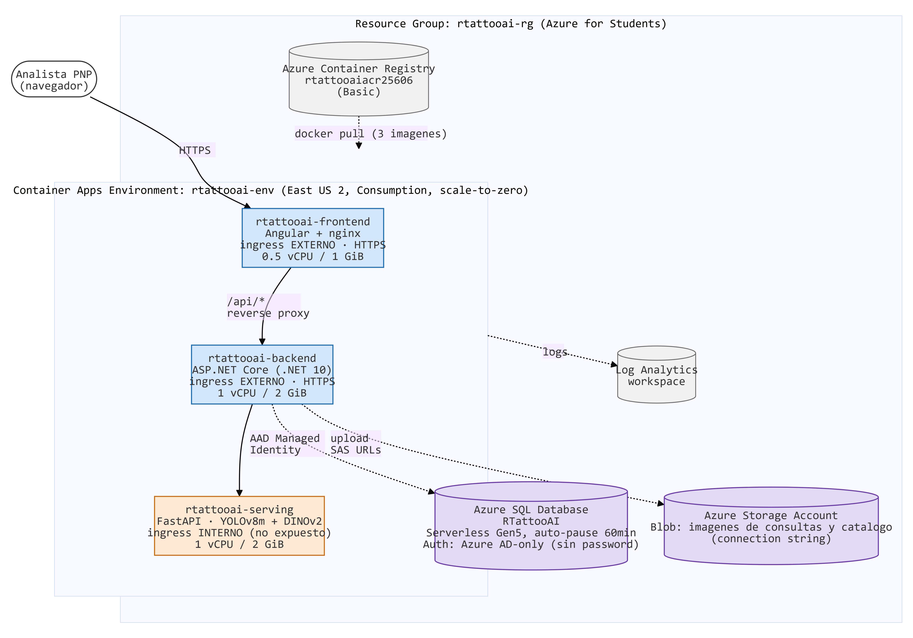

# RTattooAI — Frontend

Cliente Angular 21 del proyecto **RTattooAI**: la interfaz que usan los
analistas de la Policía Nacional del Perú (PNP) para subir una foto, revisar
las coincidencias propuestas contra el catálogo de bandas y validar (o
descartar) cada una.

> Es una herramienta de apoyo al análisis preliminar, no un sistema de
> identificación definitiva. La interfaz muestra siempre el `disclaimer` que
> devuelve el backend, y ningún resultado se presenta como una certeza.

Este repositorio es uno de los tres que componen el sistema completo. Ver
[Repositorios relacionados](#repositorios-relacionados).

## Pantallas

- **Nuevo análisis** — sube una imagen, llama al backend y muestra el
  progreso hasta tener resultado.
- **Resultados** — cajas detectadas sobre la imagen, semáforo de confianza
  por coincidencia, y los botones de validación pericial (confirmar / marcar
  para revisión / descartar) por cada detección.
- **Historial de consultas** — listado con miniatura, estado, mejor
  coincidencia y filtros por estado/texto.
- **Catálogo de tatuajes** — alta de tatuajes desde detecciones validadas y
  asignación de banda a los que aún no la tienen.
- **Gestión de usuarios** (solo admin) — CRUD básico con roles
  (`analyst` / `supervisor` / `admin`).
- **Panel de control** (admin/supervisor) — métricas de uso: volumen de
  análisis, validación pericial, catálogo, usuarios y tendencia de 30 días.

## Arquitectura del repo

```
src/app/
├── core/
│   ├── auth/      auth.service, auth.guard, role.guard, jwt.interceptor
│   ├── api/       un servicio HTTP por recurso del contrato (analysis,
│   │              catalog, users, dashboard, auth)
│   ├── models/    espejo del contrato del backend, en camelCase
│   └── utils/
├── features/
│   ├── auth/login
│   ├── analysis/upload, analysis/results
│   ├── history
│   ├── catalog/enroll        catálogo + alta desde detecciones
│   └── admin/users, admin/dashboard   gateadas por rol
└── shared/
    ├── components/   disclaimer-banner, confidence-semaforo, bbox-overlay,
    │                 image-dropzone
    ├── layout/shell  layout con sidebar y guards de ruta
    └── ui/           icon, logo-mark, tattoo-thumb, feature-placeholder
```

Convenciones: componentes **standalone**, **signals** (sin `NgModel`/
`FormsModule`), tipado estricto, interceptor que agrega el JWT y redirige a
`/login` en un 401. La URL del backend sale de `environment`, nunca
hardcodeada. Las cajas (bbox) se dibujan escalando de píxeles de la imagen
original al tamaño renderizado.

### Despliegue

Build de producción servido por nginx en Azure Container Apps, junto al
backend y al servicio de IA. Diagrama completo:



## Repositorios relacionados

| Repo | Contenido |
|------|-----------|
| [`rtattooai-backend`](https://github.com/RTattooAI/rtattooai-backend) | API ASP.NET Core que este frontend consume |
| [`rtattooai-ml`](https://github.com/RTattooAI/rtattooai-ml) | Entrenamiento de los modelos (YOLOv8 + DINOv2) y el microservicio de inferencia |

El contrato de API que conecta los tres repos está en
[`RTattooAI_API_CONTRACT.md`](RTattooAI_API_CONTRACT.md) (espejado también en
los otros dos repos).

## Cómo correrlo en local

Requisitos: Node 22 LTS, Angular CLI 21.

```bash
npm install

# proxy.conf.json redirige /api al backend local y evita problemas de CORS
ng serve
```

Abre `http://localhost:4200`. La URL real del backend para cada entorno se
configura en `src/environments/`.

### Pruebas y build

```bash
npx tsc --noEmit -p tsconfig.app.json   # type-check
ng test                                  # unit tests (Vitest)
ng build                                 # build de producción a dist/
```

## Documentación adicional

- [`CLAUDE.md`](CLAUDE.md) — contexto, convenciones y reglas de trabajo para
  desarrollar sobre este repo.
- [`RTattooAI_API_CONTRACT.md`](RTattooAI_API_CONTRACT.md) — contrato de API
  congelado entre frontend, backend y servicio de IA.
- [`RTattooAI_FRONTEND_PLAN.md`](RTattooAI_FRONTEND_PLAN.md) /
  [`RTattooAI_FRONTEND_HANDOFF.md`](RTattooAI_FRONTEND_HANDOFF.md) — plan de
  pantallas y notas de traspaso.

## Convenciones de trabajo

- Solo ramas `feature/*` o `fix/*`; nunca commits directos a `main`.
- Sin secretos en el repo bajo ninguna circunstancia.
